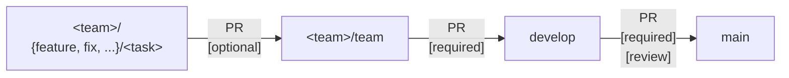

# Участие в разработке

Руководство по работе с репозиторием: ветвление, коммиты, Pull Requests (PR) и проверки кода.

## Начало работы

Для работы необходимы Git и доступ к репозиторию.

```bash
git clone git@github.com:mephi-s24501/digital-circuitry-2026.git
cd digital-circuitry-2026
```

## Организация разработки

Изменения последовательно интегрируются из рабочих веток в `main`:



<!-- markdownlint-disable no-inline-html -->

| Ветка | Назначение и правила |
| ---   | ---                  |
| `main`                              | Основная защищенная ветка; PR-only |
| `develop`                           | Межкомандная интеграция; <br> разработчики используют PR, Tech Leads могут direct push |
| `<team>/team`                       | Общая ветка команды; PR на усмотрение команды                 |
| `<team>/{feature, fix, ...}/<task>` | Рабочие внутрикомандные ветки для выполнения конкретных задач |

<!-- markdownlint-enable no-inline-html -->

Используйте короткие понятные названия `<task>` в `kebab-case`.

## Внесение изменений

### Создание рабочей ветки

Создайте рабочую ветку от актуальной `<team>/team`. Например, для разработки PLL:

```bash
git fetch origin
git switch -c integration/feature/pll origin/integration/team
```

### Оформление коммитов

Используйте стандарт [Conventional Commits](https://www.conventionalcommits.org/en/v1.0.0/):

```text
<type>[(<scope>)]: <description>
```

`scope` опционален. Примеры:

```text
feat(integration): add PLL
fix(integration): correct reset
docs: update README
```

Допустимые типы: `build`, `chore`, `ci`, `docs`, `feat`, `fix`, `perf`, `refactor`, `revert`, `style`, `test`.

Создание коммита и публикация ветки:

```bash
git add <path/to/changed/files>
git commit -m "feat(integration): add PLL"
git push -u origin integration/feature/pll
```

### Pull Request

После публикации откройте PR через **GitHub → Pull requests → New pull request**.

Например, для передачи изменений в командную ветку:

`integration/team` ← `integration/feature/pll`.

Для незавершенной работы используйте Draft PR.

Последующие `git push` в исходную ветку автоматически обновляют PR.

## Обновление веток

Перед работой синхронизируйте ветку с ее удаленной версией и родительской веткой.

Рабочая директория должна быть чистой (`git status`).

### Обновление `main`

```bash
git switch main &&
git pull --ff-only
```

### Обновление остальных веток

Например, для синхронизации `<team>/team` с `develop`:

```bash
git fetch origin &&
git switch <team>/team &&
git merge --ff --no-edit origin/<team>/team && # Branch to synchronize
git merge --ff --no-edit origin/develop        # Parent branch
```

Для других веток замените имена целевой и родительской веток согласно иерархии репозитория.

Если рабочая ветка еще не опубликована в `origin`, пропустите первое слияние.

При возникновении конфликтов исправьте их и завершите слияние (`git add`, `git merge --continue`) либо отмените его (`git merge --abort`). После завершения слияния выполните оставшиеся команды.

## Проверки кода

### GitHub Actions

При PR в `main` или `develop`, а также после direct push в `develop`, автоматически запускаются:

| Проверка | Назначение |
| ---      | ---        |
| **Commit Messages**  | Проверка сообщений коммитов                    |
| **Lint Files**       | Синтаксис, форматирование и другие правила     |
| **VHDL Style (VSG)** | Проверка стиля VHDL; сейчас не блокирует merge |

### Локальные проверки (опционально)

Для обнаружения ошибок **до отправки PR** установите [`prek`](https://prek.j178.dev/installation/) версии **0.5.5+** и активируйте Git-хуки:

```bash
prek install
```

После этого файлы и сообщения коммитов будут автоматически проверяться при создании коммитов.

Ручной запуск:

```bash
prek run --all-files                         # Общие линтеры
prek run vsg --hook-stage manual --all-files # Стиль VHDL
```

### Интеграция с редактором (опционально)

Для проверки кода непосредственно в редакторе используйте линтеры и расширения с конфигурациями репозитория:

- [`.editorconfig`](.editorconfig) — общие правила форматирования.
- [`.pre-commit-config.yaml`](.pre-commit-config.yaml) — настройки проверок `prek`.
- [`config/`](config/) — конфигурации Commitlint, Markdownlint, VSG и других линтеров.

Для VS Code доступны [рекомендуемые расширения](.vscode/extensions.json) и [настройки редактора](.vscode/settings.json).

**Локальные инструменты необязательны:** CI выполняет проверки независимо от редактора и окружения разработчика.
