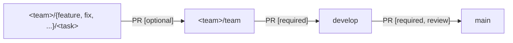

# Участие в разработке

Руководство по работе с репозиторием: ветвление, коммиты, Pull Requests (PR) и проверки кода.

## Начало работы

Для работы необходимы Git и доступ к репозиторию. Клонируйте репозиторий для начала работы:

```bash
git clone git@github.com:mephi-s24501/digital-circuitry-2026.git
cd digital-circuitry-2026
```

Работайте в директории своего модуля внутри [`fpga-onfi-controller/`](fpga-onfi-controller/). Изменения общих файлов и интерфейсов согласовывайте с затронутыми командами.

## Организация разработки

Изменения последовательно интегрируются из рабочих веток в `main`:



| Ветка | Назначение и правила |
| --- | --- |
| `main` | Основная защищенная ветка; изменения только через PR |
| `develop` | Межкомандная интеграция; разработчики используют PR, Tech Leads могут выполнять direct push |
| `<team>/team` | Общая ветка команды; PR на усмотрение команды |
| `<team>/{feature, fix, ...}/<task>` | Рабочие ветки для отдельных задач |

Используйте короткие понятные названия `<task>` в `kebab-case`.

## Обновление веток

Перед началом работы обновите свою ветку из ее удаленной версии и родительской ветки.

Проверьте рабочую директорию:

```bash
git status
```

Если есть незакоммиченные изменения, сначала сохраните их коммитом или временно уберите с помощью `git stash push -u`. Восстанавливайте их через `git stash pop` в той ветке, из которой убрали.

### Обновление `main`

```bash
git switch main &&
git pull --ff-only
```

### Обновление остальных веток

Например, для синхронизации `integration/team` с `develop`:

```bash
git fetch origin &&
git switch integration/team &&
git merge --ff --no-edit origin/integration/team &&
git merge --ff --no-edit origin/develop
```

Первая операция `merge` получает изменения удаленной версии текущей ветки, вторая — изменения родительской ветки.

Для других веток замените имена в командах согласно таблице:

| Текущая ветка | Родительская ветка |
| --- | --- |
| `develop` | `main` |
| `<team>/team` | `develop` |
| Рабочая ветка команды | `<team>/team` |

Если возникли конфликты, исправьте их в файлах, добавьте исправленные файлы через `git add` и выполните `git merge --continue`. Для отмены незавершенного слияния используйте `git merge --abort`. После разрешения конфликтов выполните оставшиеся команды обновления.

Не переписывайте историю общих веток и **НЕ используйте** `force push` для их обновления.

## Внесение изменений

### Создание рабочей ветки

Создайте рабочую ветку от актуальной командной ветки. Например, для разработки PLL:

```bash
git fetch origin &&
git switch -c integration/feature/pll origin/integration/team
```

### Оформление коммитов

Используйте стандарт [Conventional Commits](https://www.conventionalcommits.org/en/v1.0.0/):

```text
<type>[(<scope>)]: <description>
```

`scope` опционален. Допустимые типы: `build`, `chore`, `ci`, `docs`, `feat`, `fix`, `perf`, `refactor`, `revert`, `style`, `test`.

- `type` и `scope` должны быть в lower case.
- Описание рекомендуется начинать со строчной буквы. Заглавная буква в начале допустима для аббревиатур. Правило вызывает предупреждение, но не блокирует коммит и CI.
- Аббревиатуры разрешены, но описание полностью в UPPER CASE запрещено.

Примеры:

```text
feat(integration): add PLL
fix(buffering): resolve FIFO overflow
docs: update README
```

Добавьте файлы, относящиеся к задаче, и проверьте содержимое будущего коммита.

```bash
git add -- path/to/file
git diff --cached
git commit -m "feat(integration): add PLL"
```

При первой публикации ветки:

```bash
git push -u origin integration/feature/pll
```

Для последующих обновлений опубликованной ветки достаточно `git push`.

Не добавляйте в коммиты временные файлы, результаты сборки и симуляции, не относящиеся к задаче.

### Pull Request

После публикации откройте PR через **GitHub → Pull requests → New pull request**.

Для передачи изменений из рабочей ветки в командную укажите:

- `base`: `integration/team` — куда вносятся изменения;
- `compare`: `integration/feature/pll` — откуда вносятся изменения.

Кратко опишите, что изменилось и как это проверялось. Для незавершенной работы используйте Draft PR. Последующие `git push` в исходную ветку автоматически обновляют PR.

При интеграции в `develop` и `main` используйте **Create a merge commit**. Перед слиянием дождитесь обязательных проверок и необходимых ревью.

## Проверки кода

### GitHub Actions

При PR в `main` или `develop`, а также после push в `develop`, автоматически запускаются:

| Проверка | Назначение | Обязательна для PR |
| --- | --- | --- |
| **Commit Messages** | Проверка сообщений коммитов | Да |
| **Lint Files** | Синтаксис, форматирование и целостность файлов | Да |
| **VHDL Style (VSG)** | Проверка стиля VHDL | Нет |

При PR в командные ветки CI не запускается.

Если проверка не прошла, откройте **Checks** в PR, найдите упавшую проверку и прочитайте ее вывод. Исправьте причину ошибки и отправьте изменения в ту же ветку. Новый PR создавать не нужно.

Предупреждения Commitlint и ошибки необязательной проверки VSG сами по себе не блокируют слияние.

### Локальные проверки (опционально)

Чтобы обнаруживать ошибки до отправки изменений, установите [`prek`](https://prek.j178.dev/installation/) версии **0.5.5+** и активируйте Git-хуки из корня репозитория:

```bash
prek install
```

После этого файлы и сообщения коммитов будут автоматически проверяться при создании коммитов.

Ручной запуск из корня репозитория:

```bash
# Общие проверки файлов
prek run --all-files

# Общие правила оформления файлов
prek run editorconfig-checker --hook-stage manual --all-files

# Стиль VHDL
prek run vsg --hook-stage manual --all-files
```

Локальные проверки необязательны, но рекомендуются (это убережет нервы в дальнейшем, когда commitlint всплывет слишком поздно на CI).

### Интеграция с редактором (опционально)

Используйте настройки репозитория независимо от выбранного редактора:

- [`.editorconfig`](.editorconfig) — общие правила форматирования.
- [`.pre-commit-config.yaml`](.pre-commit-config.yaml) — настройки проверок `prek`.
- [`config/`](config/) — конфигурации линтеров.

Для VS Code доступны [рекомендуемые расширения](.vscode/extensions.json) и [настройки редактора](.vscode/settings.json).
