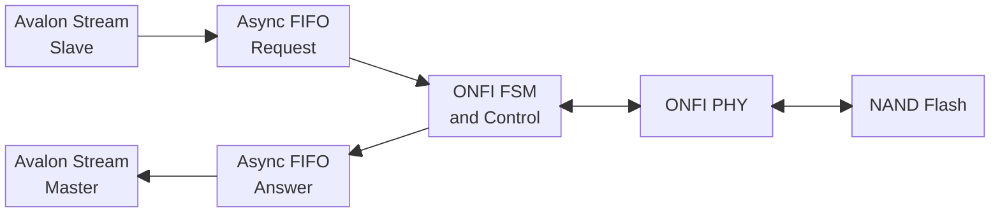

# FPGA ONFI Controller

В рамках курсовой работы по дисциплине **«Схемотехника цифровых устройств»** требуется выполнить групповой проект по разработке модели контроллера ONFI. В результате выполнения курсового проекта требуется разработать каждый из модулей в отдельности, верифицировать их в отдельности, выполнить синтез, осуществить общую сборку проекта и протестировать работу контроллера на базе отладочной платы Cyc1000 (или аналогичного класса на базе Cyclone 10 LP), прошив ПЛИС **Cyclone 10LP** фирмы Intel (10CL025YU256C8G) и проверив взаимодействие контроллера с NAND FLASH или отработку протокола обмена на логическом анализаторе.

## Архитектура

Контроллер состоит из следующих функциональных блоков:

| Блок | Назначение |
| ---  | ---        |
| **Avalon Stream Slave**  | Прием запросов и данных от внешней системы                         |
| **Avalon Stream Master** | Передача ответов и данных во внешнюю систему                       |
| **Async FIFO Request**   | Буферизация входящих запросов между частями контроллера            |
| **Async FIFO Answer**    | Буферизация ответов и данных, возвращаемых контроллером            |
| **ONFI FSM and Control** | Управление последовательностью операций и формирование команд ONFI |
| **ONFI PHY**             | Обмен сигналами с NAND Flash на уровне физического интерфейса      |

## Требования к проекту

1. **Ширина шины данных для интерфейса Avalon Stream** — фиксирована и составляет 64 бита.
2. **Буферизация** — отдельная для запросов/откликов чтения и записи.
3. **Параметры интерфейса ONFI задаются через generics:** версия, длина пакетов, скоростные параметры.
4. **Набор команд ONFI** — минимально необходимый для записи данных, чтения данных, идентификации NAND.

## Участие в разработке

Инструкции по подготовке рабочего окружения, клонированию репозитория, настройке локальных проверок и правилам совместной разработки приведены в [`CONTRIBUTING.md`](../CONTRIBUTING.md).
